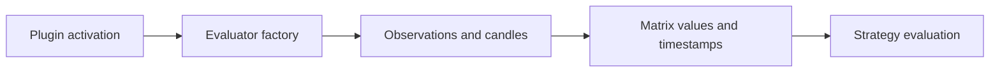
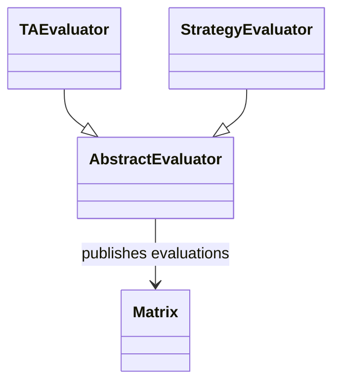
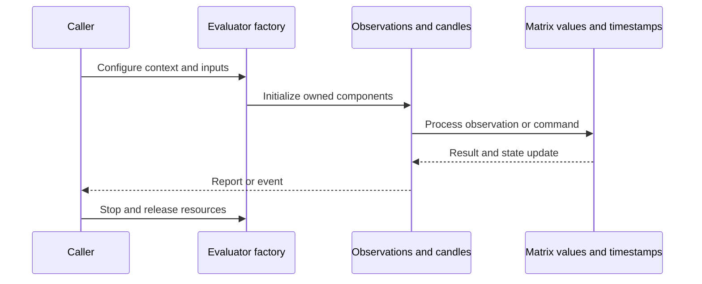
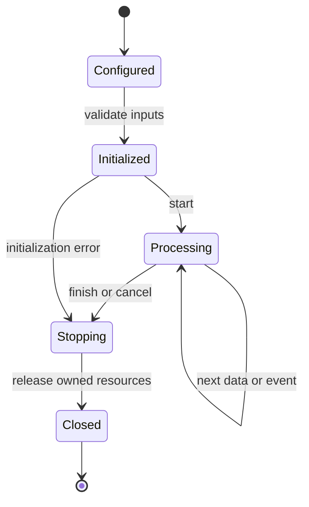
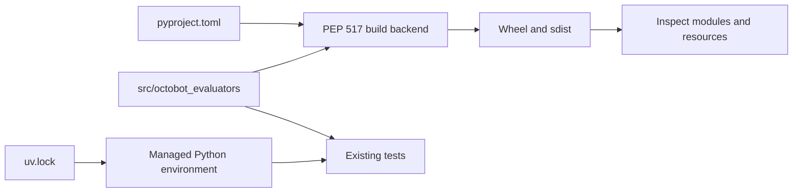
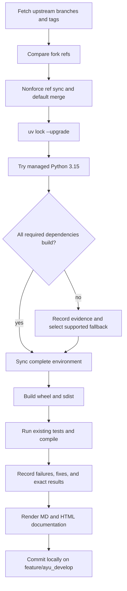

# OctoBot-Evaluators: architecture and development

Evaluators turns market and service observations into timestamped evaluation values, then combines those values through strategy evaluators. It is a signal-processing library; order submission belongs to Trading.

## Components and boundaries

AbstractEvaluator defines the plugin lifecycle and common context. TAEvaluator, SocialEvaluator, RealTimeEvaluator, ScriptedEvaluator, and StrategyEvaluator specialize data sources and trigger behavior. The factory instantiates activated plugins per exchange/symbol/time frame. Matrix and Matrices store hierarchical values with timestamps and metadata; channel producers announce updates, and strategy evaluators inspect relevant children.

The following class view names implementation classes. Cross-package types are supplied by the host ecosystem; arrows describe inheritance or usage, not copied ownership.

## Runtime workflow

Load activation and strategy configuration, create a matrix and evaluator channels, discover plugin classes, initialize required candles/time frames, instantiate evaluators, process observations, write matrix values, and notify strategy consumers. Evaluation validity checks reject missing or stale values before combination.

This sequence is an architectural view of responsibility and resource ownership. Individual plugin, connector, and strategy implementations can add asynchronous events and error branches. The lifecycle below is a conceptual operating workflow, rather than a claim that every component has one shared state enum.

## Features and extension points

Technical, social, real-time and scripted evaluator families; hierarchical matrix queries; plugin activation and priority; strategy time-frame/candle requirements; cache-aware local evaluation context.

Extend the owning component behind its existing public interface. Keep metadata and configuration alongside plugin/strategy resources. Exchange-specific behavior belongs in an adapter; strategy decisions belong in the strategy/evaluator layer; persistence schema and migrations belong with the storage implementation. Review the source map below before changing a boundary, and exercise the existing tests associated with that boundary.

## Packaging and dependency design

The standalone framework uses sibling Commons and the licensed Tentacles Manager 2.10 compatibility source described in [its provenance](../vendor/tentacles-manager/PROVENANCE.md). The adjacent [latest Tulipy source](../../OctoBot/vendor/octobot-tulipy/PROVENANCE.md) supports a complete Python 3.15 native build while preserving original indicator arithmetic. All 57 original standalone cases pass; original assertions remain intact.

The lock records exact package versions, hashes, platform markers, and local source mappings. Path sources deliberately bind related repositories in this workspace; clone sibling repositories at the documented names before synchronization. Published packaging metadata describes public dependencies, while uv source settings select this development workspace. Resolve dependency changes with uv lock --upgrade and retain the generated lock, then verify the same locked environment.

## Maintenance workflow

All upstream branches and tags are fetched. Fork updates use nonforce pushes; a divergent branch is merged without erasing fork history. The default branch is merged into feature/ayu_develop with package/resource conflicts reconciled in their installed locations. Build and test evidence is recorded before a local maintenance commit. Feature branch publication is a separate root-level action.

No existing test assertions are removed and no new test cases are introduced in this maintenance pass. Corrected fixtures preserve coverage while making paths, corruption inputs, and resource cleanup compatible with the selected interpreter. A failed test or unsupported dependency is reported explicitly in [validation](validation.md); package build success does not imply strategy correctness, profitability, or successful live connectivity.

## Source map

| Source | Responsibility and location |
| --- | --- |
| [abstract_evaluator.py](../src/octobot_evaluators/evaluators/abstract_evaluator.py) | src/octobot_evaluators/evaluators/abstract_evaluator.py |
| [TA_evaluator.py](../src/octobot_evaluators/evaluators/TA_evaluator.py) | src/octobot_evaluators/evaluators/TA_evaluator.py |
| [strategy_evaluator.py](../src/octobot_evaluators/evaluators/strategy_evaluator.py) | src/octobot_evaluators/evaluators/strategy_evaluator.py |
| [social_evaluator.py](../src/octobot_evaluators/evaluators/social_evaluator.py) | src/octobot_evaluators/evaluators/social_evaluator.py |
| [evaluator_factory.py](../src/octobot_evaluators/evaluators/evaluator_factory.py) | src/octobot_evaluators/evaluators/evaluator_factory.py |
| [matrix.py](../src/octobot_evaluators/matrix/matrix.py) | src/octobot_evaluators/matrix/matrix.py |
| [matrices.py](../src/octobot_evaluators/matrix/matrices.py) | src/octobot_evaluators/matrix/matrices.py |
| [matrix_manager.py](../src/octobot_evaluators/matrix/matrix_manager.py) | src/octobot_evaluators/matrix/matrix_manager.py |
| [initialization.py](../src/octobot_evaluators/api/initialization.py) | src/octobot_evaluators/api/initialization.py |
| [evaluation_util.py](../src/octobot_evaluators/util/evaluation_util.py) | src/octobot_evaluators/util/evaluation_util.py |
| [pyproject.toml](../pyproject.toml) | pyproject.toml |
| [uv.lock](../uv.lock) | uv.lock |
| [README.md](../README.md) | README.md |

## Further reading

Use [development.md](development.md) for reproducible commands and [validation.md](validation.md) for exact interpreter, dependency, build, test, and blocker evidence. The equivalent [HTML architecture document](ayu-develop.html) supports browsing and rendered diagrams.
