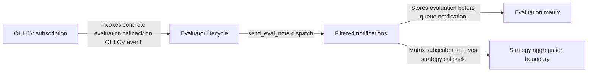
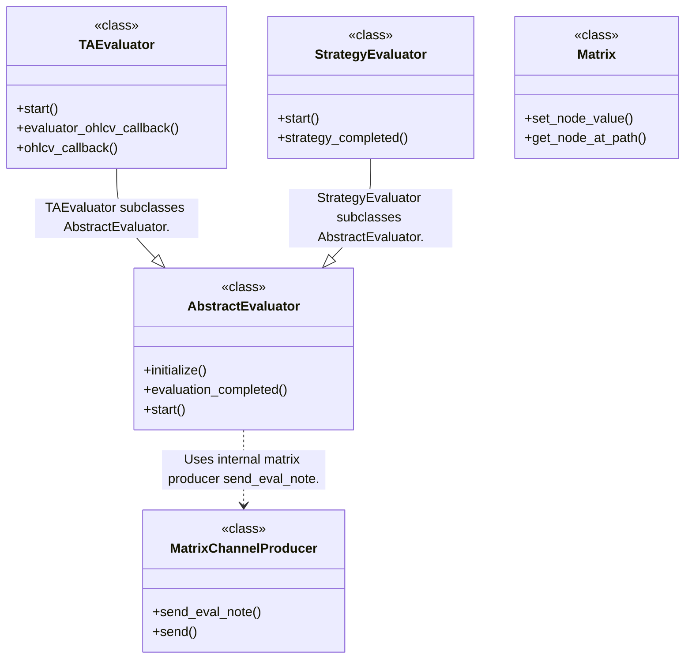
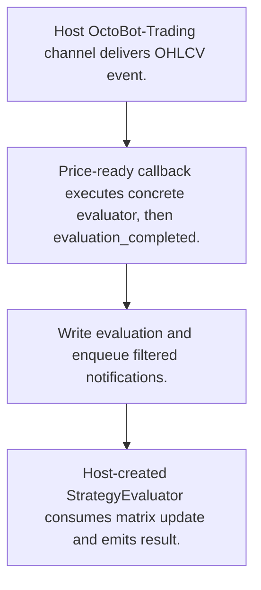
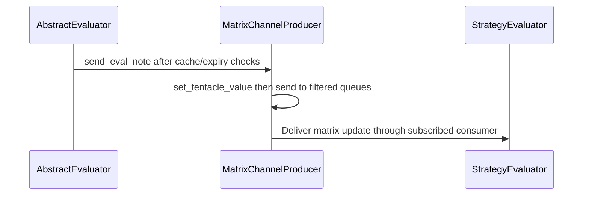

# OctoBot-Evaluators: workflow, design and architecture

Updated: **2026-10-13**
Reviewed Git hash: `e622bb6586e74b031efef7b25c6018f214fe9f90`
Branch: `feature/ayu_develop`
Source diff SHA256: `e3b0c44298fc1c149afbf4c8996fb92427ae41e4649b934ca495991b7852b855`
Scope: **Signal/evaluator framework** / Maintenance: **companion**
Languages: Python

[HTML edition](ayu-develop.html) / [Development](development.md) / [Historical validation](validation.md) / [Full system comparison](../../docs/index.html)

## Purpose and scope

Expose evaluator lifecycle and market-data callbacks, store typed timestamped evaluations in a matrix, and notify strategy consumers.

## Features and support boundaries

Native = implemented here. Integration = supplied through a named host/API. Limited = material restriction. Not provided = evidenced scope exclusion. Unverified = support/absence not established. Not applicable = outside this artifact type.

| Capability | Status | Implementation and limits | Source |
|---|---|---|---|
| Backtesting | Integration | Callbacks consume OctoBot-Trading host channels; historical/live data acquisition and venue connectors belong to that host. | [TAEvaluator.start](../src/octobot_evaluators/evaluators/TA_evaluator.py) ([L40](https://github.com/alexcwyu/OctoBot-Evaluators/blob/e622bb6586e74b031efef7b25c6018f214fe9f90/src/octobot_evaluators/evaluators/TA_evaluator.py#L40)) / [TAEvaluator.evaluator_ohlcv_callback](../src/octobot_evaluators/evaluators/TA_evaluator.py) ([L85](https://github.com/alexcwyu/OctoBot-Evaluators/blob/e622bb6586e74b031efef7b25c6018f214fe9f90/src/octobot_evaluators/evaluators/TA_evaluator.py#L85)) |
| Live execution | Not applicable | Signal framework publishes evaluations; host trading modes/traders consume them and execute orders. | [AbstractEvaluator.evaluation_completed](../src/octobot_evaluators/evaluators/abstract_evaluator.py) ([L273](https://github.com/alexcwyu/OctoBot-Evaluators/blob/e622bb6586e74b031efef7b25c6018f214fe9f90/src/octobot_evaluators/evaluators/abstract_evaluator.py#L273)) / [MatrixChannelProducer.send_eval_note](../src/octobot_evaluators/matrix/channel/matrix.py) ([L80](https://github.com/alexcwyu/OctoBot-Evaluators/blob/e622bb6586e74b031efef7b25c6018f214fe9f90/src/octobot_evaluators/matrix/channel/matrix.py#L80)) |
| Paper trading | Not applicable | Signal framework publishes evaluations; host trading modes/traders consume them and execute orders. | [AbstractEvaluator.evaluation_completed](../src/octobot_evaluators/evaluators/abstract_evaluator.py) ([L273](https://github.com/alexcwyu/OctoBot-Evaluators/blob/e622bb6586e74b031efef7b25c6018f214fe9f90/src/octobot_evaluators/evaluators/abstract_evaluator.py#L273)) / [MatrixChannelProducer.send_eval_note](../src/octobot_evaluators/matrix/channel/matrix.py) ([L80](https://github.com/alexcwyu/OctoBot-Evaluators/blob/e622bb6586e74b031efef7b25c6018f214fe9f90/src/octobot_evaluators/matrix/channel/matrix.py#L80)) |
| Event driven | Native | Evaluator subclasses and filtered matrix notifications provide native signal extension lifecycle. | [AbstractEvaluator.evaluation_completed](../src/octobot_evaluators/evaluators/abstract_evaluator.py) ([L273](https://github.com/alexcwyu/OctoBot-Evaluators/blob/e622bb6586e74b031efef7b25c6018f214fe9f90/src/octobot_evaluators/evaluators/abstract_evaluator.py#L273)) / [TAEvaluator.start](../src/octobot_evaluators/evaluators/TA_evaluator.py) ([L40](https://github.com/alexcwyu/OctoBot-Evaluators/blob/e622bb6586e74b031efef7b25c6018f214fe9f90/src/octobot_evaluators/evaluators/TA_evaluator.py#L40)) / [StrategyEvaluator.start](../src/octobot_evaluators/evaluators/strategy_evaluator.py) ([L58](https://github.com/alexcwyu/OctoBot-Evaluators/blob/e622bb6586e74b031efef7b25c6018f214fe9f90/src/octobot_evaluators/evaluators/strategy_evaluator.py#L58)) / [MatrixChannelProducer.send_eval_note](../src/octobot_evaluators/matrix/channel/matrix.py) ([L80](https://github.com/alexcwyu/OctoBot-Evaluators/blob/e622bb6586e74b031efef7b25c6018f214fe9f90/src/octobot_evaluators/matrix/channel/matrix.py#L80)) |
| Vectorized | Unverified | Representative source review did not establish this capability; no claim of absence. | Not applicable to this repository scope. |
| Order management | Not applicable | Signal framework publishes evaluations; host trading modes/traders consume them and execute orders. | [AbstractEvaluator.evaluation_completed](../src/octobot_evaluators/evaluators/abstract_evaluator.py) ([L273](https://github.com/alexcwyu/OctoBot-Evaluators/blob/e622bb6586e74b031efef7b25c6018f214fe9f90/src/octobot_evaluators/evaluators/abstract_evaluator.py#L273)) / [MatrixChannelProducer.send_eval_note](../src/octobot_evaluators/matrix/channel/matrix.py) ([L80](https://github.com/alexcwyu/OctoBot-Evaluators/blob/e622bb6586e74b031efef7b25c6018f214fe9f90/src/octobot_evaluators/matrix/channel/matrix.py#L80)) |
| Order types | Not applicable | Signal framework publishes evaluations; host trading modes/traders consume them and execute orders. | [AbstractEvaluator.evaluation_completed](../src/octobot_evaluators/evaluators/abstract_evaluator.py) ([L273](https://github.com/alexcwyu/OctoBot-Evaluators/blob/e622bb6586e74b031efef7b25c6018f214fe9f90/src/octobot_evaluators/evaluators/abstract_evaluator.py#L273)) / [MatrixChannelProducer.send_eval_note](../src/octobot_evaluators/matrix/channel/matrix.py) ([L80](https://github.com/alexcwyu/OctoBot-Evaluators/blob/e622bb6586e74b031efef7b25c6018f214fe9f90/src/octobot_evaluators/matrix/channel/matrix.py#L80)) |
| Multi venue | Integration | Callbacks consume OctoBot-Trading host channels; historical/live data acquisition and venue connectors belong to that host. | [TAEvaluator.start](../src/octobot_evaluators/evaluators/TA_evaluator.py) ([L40](https://github.com/alexcwyu/OctoBot-Evaluators/blob/e622bb6586e74b031efef7b25c6018f214fe9f90/src/octobot_evaluators/evaluators/TA_evaluator.py#L40)) / [TAEvaluator.evaluator_ohlcv_callback](../src/octobot_evaluators/evaluators/TA_evaluator.py) ([L85](https://github.com/alexcwyu/OctoBot-Evaluators/blob/e622bb6586e74b031efef7b25c6018f214fe9f90/src/octobot_evaluators/evaluators/TA_evaluator.py#L85)) |
| Crypto | Integration | Callbacks consume OctoBot-Trading host channels; historical/live data acquisition and venue connectors belong to that host. | [TAEvaluator.start](../src/octobot_evaluators/evaluators/TA_evaluator.py) ([L40](https://github.com/alexcwyu/OctoBot-Evaluators/blob/e622bb6586e74b031efef7b25c6018f214fe9f90/src/octobot_evaluators/evaluators/TA_evaluator.py#L40)) / [TAEvaluator.evaluator_ohlcv_callback](../src/octobot_evaluators/evaluators/TA_evaluator.py) ([L85](https://github.com/alexcwyu/OctoBot-Evaluators/blob/e622bb6586e74b031efef7b25c6018f214fe9f90/src/octobot_evaluators/evaluators/TA_evaluator.py#L85)) |
| Equities | Unverified | Representative source review did not establish this capability; no claim of absence. | Not applicable to this repository scope. |
| Futures | Unverified | Representative source review did not establish this capability; no claim of absence. | Not applicable to this repository scope. |
| Options | Unverified | Representative source review did not establish this capability; no claim of absence. | Not applicable to this repository scope. |
| Forex | Unverified | Representative source review did not establish this capability; no claim of absence. | Not applicable to this repository scope. |
| Strategy api | Native | Evaluator subclasses and filtered matrix notifications provide native signal extension lifecycle. | [AbstractEvaluator.evaluation_completed](../src/octobot_evaluators/evaluators/abstract_evaluator.py) ([L273](https://github.com/alexcwyu/OctoBot-Evaluators/blob/e622bb6586e74b031efef7b25c6018f214fe9f90/src/octobot_evaluators/evaluators/abstract_evaluator.py#L273)) / [TAEvaluator.start](../src/octobot_evaluators/evaluators/TA_evaluator.py) ([L40](https://github.com/alexcwyu/OctoBot-Evaluators/blob/e622bb6586e74b031efef7b25c6018f214fe9f90/src/octobot_evaluators/evaluators/TA_evaluator.py#L40)) / [StrategyEvaluator.start](../src/octobot_evaluators/evaluators/strategy_evaluator.py) ([L58](https://github.com/alexcwyu/OctoBot-Evaluators/blob/e622bb6586e74b031efef7b25c6018f214fe9f90/src/octobot_evaluators/evaluators/strategy_evaluator.py#L58)) / [MatrixChannelProducer.send_eval_note](../src/octobot_evaluators/matrix/channel/matrix.py) ([L80](https://github.com/alexcwyu/OctoBot-Evaluators/blob/e622bb6586e74b031efef7b25c6018f214fe9f90/src/octobot_evaluators/matrix/channel/matrix.py#L80)) |
| Optimization | Unverified | Representative source review did not establish this capability; no claim of absence. | Not applicable to this repository scope. |
| Machine learning | Unverified | Representative source review did not establish this capability; no claim of absence. | Not applicable to this repository scope. |
| Reinforcement learning | Unverified | Representative source review did not establish this capability; no claim of absence. | Not applicable to this repository scope. |
| Portfolio | Not applicable | Signal framework publishes evaluations; host trading modes/traders consume them and execute orders. | [AbstractEvaluator.evaluation_completed](../src/octobot_evaluators/evaluators/abstract_evaluator.py) ([L273](https://github.com/alexcwyu/OctoBot-Evaluators/blob/e622bb6586e74b031efef7b25c6018f214fe9f90/src/octobot_evaluators/evaluators/abstract_evaluator.py#L273)) / [MatrixChannelProducer.send_eval_note](../src/octobot_evaluators/matrix/channel/matrix.py) ([L80](https://github.com/alexcwyu/OctoBot-Evaluators/blob/e622bb6586e74b031efef7b25c6018f214fe9f90/src/octobot_evaluators/matrix/channel/matrix.py#L80)) |
| Risk management | Unverified | Representative source review did not establish this capability; no claim of absence. | Not applicable to this repository scope. |
| Performance analytics | Unverified | Representative source review did not establish this capability; no claim of absence. | Not applicable to this repository scope. |
| Historical data | Integration | Callbacks consume OctoBot-Trading host channels; historical/live data acquisition and venue connectors belong to that host. | [TAEvaluator.start](../src/octobot_evaluators/evaluators/TA_evaluator.py) ([L40](https://github.com/alexcwyu/OctoBot-Evaluators/blob/e622bb6586e74b031efef7b25c6018f214fe9f90/src/octobot_evaluators/evaluators/TA_evaluator.py#L40)) / [TAEvaluator.evaluator_ohlcv_callback](../src/octobot_evaluators/evaluators/TA_evaluator.py) ([L85](https://github.com/alexcwyu/OctoBot-Evaluators/blob/e622bb6586e74b031efef7b25c6018f214fe9f90/src/octobot_evaluators/evaluators/TA_evaluator.py#L85)) |
| Streaming data | Integration | Callbacks consume OctoBot-Trading host channels; historical/live data acquisition and venue connectors belong to that host. | [TAEvaluator.start](../src/octobot_evaluators/evaluators/TA_evaluator.py) ([L40](https://github.com/alexcwyu/OctoBot-Evaluators/blob/e622bb6586e74b031efef7b25c6018f214fe9f90/src/octobot_evaluators/evaluators/TA_evaluator.py#L40)) / [TAEvaluator.evaluator_ohlcv_callback](../src/octobot_evaluators/evaluators/TA_evaluator.py) ([L85](https://github.com/alexcwyu/OctoBot-Evaluators/blob/e622bb6586e74b031efef7b25c6018f214fe9f90/src/octobot_evaluators/evaluators/TA_evaluator.py#L85)) |
| Persistence | Limited | Optional evaluation cache and tree matrix support signal storage; this is not a complete trade ledger. | [AbstractEvaluator.evaluation_completed](../src/octobot_evaluators/evaluators/abstract_evaluator.py) ([L273](https://github.com/alexcwyu/OctoBot-Evaluators/blob/e622bb6586e74b031efef7b25c6018f214fe9f90/src/octobot_evaluators/evaluators/abstract_evaluator.py#L273)) / [Matrix.set_node_value](../src/octobot_evaluators/matrix/matrix.py) ([L34](https://github.com/alexcwyu/OctoBot-Evaluators/blob/e622bb6586e74b031efef7b25c6018f214fe9f90/src/octobot_evaluators/matrix/matrix.py#L34)) |
| Data pipeline | Native | Evaluator subclasses and filtered matrix notifications provide native signal extension lifecycle. | [AbstractEvaluator.evaluation_completed](../src/octobot_evaluators/evaluators/abstract_evaluator.py) ([L273](https://github.com/alexcwyu/OctoBot-Evaluators/blob/e622bb6586e74b031efef7b25c6018f214fe9f90/src/octobot_evaluators/evaluators/abstract_evaluator.py#L273)) / [TAEvaluator.start](../src/octobot_evaluators/evaluators/TA_evaluator.py) ([L40](https://github.com/alexcwyu/OctoBot-Evaluators/blob/e622bb6586e74b031efef7b25c6018f214fe9f90/src/octobot_evaluators/evaluators/TA_evaluator.py#L40)) / [StrategyEvaluator.start](../src/octobot_evaluators/evaluators/strategy_evaluator.py) ([L58](https://github.com/alexcwyu/OctoBot-Evaluators/blob/e622bb6586e74b031efef7b25c6018f214fe9f90/src/octobot_evaluators/evaluators/strategy_evaluator.py#L58)) / [MatrixChannelProducer.send_eval_note](../src/octobot_evaluators/matrix/channel/matrix.py) ([L80](https://github.com/alexcwyu/OctoBot-Evaluators/blob/e622bb6586e74b031efef7b25c6018f214fe9f90/src/octobot_evaluators/matrix/channel/matrix.py#L80)) |
| Web ui | Unverified | Representative source review did not establish this capability; no claim of absence. | Not applicable to this repository scope. |
| Cli | Unverified | Representative source review did not establish this capability; no claim of absence. | Not applicable to this repository scope. |
| Monitoring | Unverified | Representative source review did not establish this capability; no claim of absence. | Not applicable to this repository scope. |
| Extension api | Native | Evaluator subclasses and filtered matrix notifications provide native signal extension lifecycle. | [AbstractEvaluator.evaluation_completed](../src/octobot_evaluators/evaluators/abstract_evaluator.py) ([L273](https://github.com/alexcwyu/OctoBot-Evaluators/blob/e622bb6586e74b031efef7b25c6018f214fe9f90/src/octobot_evaluators/evaluators/abstract_evaluator.py#L273)) / [TAEvaluator.start](../src/octobot_evaluators/evaluators/TA_evaluator.py) ([L40](https://github.com/alexcwyu/OctoBot-Evaluators/blob/e622bb6586e74b031efef7b25c6018f214fe9f90/src/octobot_evaluators/evaluators/TA_evaluator.py#L40)) / [StrategyEvaluator.start](../src/octobot_evaluators/evaluators/strategy_evaluator.py) ([L58](https://github.com/alexcwyu/OctoBot-Evaluators/blob/e622bb6586e74b031efef7b25c6018f214fe9f90/src/octobot_evaluators/evaluators/strategy_evaluator.py#L58)) / [MatrixChannelProducer.send_eval_note](../src/octobot_evaluators/matrix/channel/matrix.py) ([L80](https://github.com/alexcwyu/OctoBot-Evaluators/blob/e622bb6586e74b031efef7b25c6018f214fe9f90/src/octobot_evaluators/matrix/channel/matrix.py#L80)) |
| Native acceleration | Unverified | Representative source review did not establish this capability; no claim of absence. | Not applicable to this repository scope. |
| Distributed execution | Unverified | Representative source review did not establish this capability; no claim of absence. | Not applicable to this repository scope. |

## System components

| Component | Responsibility | Source |
|---|---|---|
| Evaluator lifecycle | Cache/check/send evaluation values. | [AbstractEvaluator.evaluation_completed](../src/octobot_evaluators/evaluators/abstract_evaluator.py) ([L273](https://github.com/alexcwyu/OctoBot-Evaluators/blob/e622bb6586e74b031efef7b25c6018f214fe9f90/src/octobot_evaluators/evaluators/abstract_evaluator.py#L273)) |
| OHLCV subscription | Translate host candle events to evaluator callbacks. | [TAEvaluator.start](../src/octobot_evaluators/evaluators/TA_evaluator.py) ([L40](https://github.com/alexcwyu/OctoBot-Evaluators/blob/e622bb6586e74b031efef7b25c6018f214fe9f90/src/octobot_evaluators/evaluators/TA_evaluator.py#L40)) |
| Strategy aggregation boundary | Subscribe to matrix updates and emit strategy evaluations. | [StrategyEvaluator.start](../src/octobot_evaluators/evaluators/strategy_evaluator.py) ([L58](https://github.com/alexcwyu/OctoBot-Evaluators/blob/e622bb6586e74b031efef7b25c6018f214fe9f90/src/octobot_evaluators/evaluators/strategy_evaluator.py#L58)) |
| Evaluation matrix | Typed tree-backed values and timestamps. | [Matrix.set_node_value](../src/octobot_evaluators/matrix/matrix.py) ([L34](https://github.com/alexcwyu/OctoBot-Evaluators/blob/e622bb6586e74b031efef7b25c6018f214fe9f90/src/octobot_evaluators/matrix/matrix.py#L34)) |
| Filtered notifications | Persist matrix updates and enqueue consumer messages. | [MatrixChannelProducer.send_eval_note](../src/octobot_evaluators/matrix/channel/matrix.py) ([L80](https://github.com/alexcwyu/OctoBot-Evaluators/blob/e622bb6586e74b031efef7b25c6018f214fe9f90/src/octobot_evaluators/matrix/channel/matrix.py#L80)) |

## Architecture and component boundaries

The component view summarizes inspected responsibility boundaries. Arrows identify the documented API/data dependencies; this is not a deployment-readiness claim.

- Invokes concrete evaluation callback on OHLCV event.: [TAEvaluator.evaluator_ohlcv_callback](../src/octobot_evaluators/evaluators/TA_evaluator.py) ([L85](https://github.com/alexcwyu/OctoBot-Evaluators/blob/e622bb6586e74b031efef7b25c6018f214fe9f90/src/octobot_evaluators/evaluators/TA_evaluator.py#L85))
- send_eval_note dispatch.: [AbstractEvaluator.evaluation_completed](../src/octobot_evaluators/evaluators/abstract_evaluator.py) ([L273](https://github.com/alexcwyu/OctoBot-Evaluators/blob/e622bb6586e74b031efef7b25c6018f214fe9f90/src/octobot_evaluators/evaluators/abstract_evaluator.py#L273))
- Stores evaluation before queue notification.: [MatrixChannelProducer.send_eval_note](../src/octobot_evaluators/matrix/channel/matrix.py) ([L80](https://github.com/alexcwyu/OctoBot-Evaluators/blob/e622bb6586e74b031efef7b25c6018f214fe9f90/src/octobot_evaluators/matrix/channel/matrix.py#L80))
- Matrix subscriber receives strategy callback.: [StrategyEvaluator.start](../src/octobot_evaluators/evaluators/strategy_evaluator.py) ([L58](https://github.com/alexcwyu/OctoBot-Evaluators/blob/e622bb6586e74b031efef7b25c6018f214fe9f90/src/octobot_evaluators/evaluators/strategy_evaluator.py#L58)) / [MatrixChannelProducer.send](../src/octobot_evaluators/matrix/channel/matrix.py) ([L45](https://github.com/alexcwyu/OctoBot-Evaluators/blob/e622bb6586e74b031efef7b25c6018f214fe9f90/src/octobot_evaluators/matrix/channel/matrix.py#L45))

## Design decisions

| Decision | Rationale | Tradeoff | Evidence |
|---|---|---|---|
| Store evaluation before notifying consumers. | Subscribers can query consistent typed/time-scoped matrix values when they wake. | Consumers must respect freshness and full-cycle validity checks. | [MatrixChannelProducer.send_eval_note](../src/octobot_evaluators/matrix/channel/matrix.py) ([L80](https://github.com/alexcwyu/OctoBot-Evaluators/blob/e622bb6586e74b031efef7b25c6018f214fe9f90/src/octobot_evaluators/matrix/channel/matrix.py#L80)) / [StrategyEvaluator.start](../src/octobot_evaluators/evaluators/strategy_evaluator.py) ([L58](https://github.com/alexcwyu/OctoBot-Evaluators/blob/e622bb6586e74b031efef7b25c6018f214fe9f90/src/octobot_evaluators/evaluators/strategy_evaluator.py#L58)) |

## Class and interface relationships

Each node is a reviewed source symbol. Function/module nodes are explicitly labeled; they do not imply Python classes. Only reviewed relationships are drawn.

- **AbstractEvaluator** (class): [AbstractEvaluator.evaluation_completed](../src/octobot_evaluators/evaluators/abstract_evaluator.py) ([L273](https://github.com/alexcwyu/OctoBot-Evaluators/blob/e622bb6586e74b031efef7b25c6018f214fe9f90/src/octobot_evaluators/evaluators/abstract_evaluator.py#L273))
- **TAEvaluator** (class): [TAEvaluator.start](../src/octobot_evaluators/evaluators/TA_evaluator.py) ([L40](https://github.com/alexcwyu/OctoBot-Evaluators/blob/e622bb6586e74b031efef7b25c6018f214fe9f90/src/octobot_evaluators/evaluators/TA_evaluator.py#L40))
- **StrategyEvaluator** (class): [StrategyEvaluator.start](../src/octobot_evaluators/evaluators/strategy_evaluator.py) ([L58](https://github.com/alexcwyu/OctoBot-Evaluators/blob/e622bb6586e74b031efef7b25c6018f214fe9f90/src/octobot_evaluators/evaluators/strategy_evaluator.py#L58))
- **Matrix** (class): [Matrix.set_node_value](../src/octobot_evaluators/matrix/matrix.py) ([L34](https://github.com/alexcwyu/OctoBot-Evaluators/blob/e622bb6586e74b031efef7b25c6018f214fe9f90/src/octobot_evaluators/matrix/matrix.py#L34))
- **MatrixChannelProducer** (class): [MatrixChannelProducer.send_eval_note](../src/octobot_evaluators/matrix/channel/matrix.py) ([L80](https://github.com/alexcwyu/OctoBot-Evaluators/blob/e622bb6586e74b031efef7b25c6018f214fe9f90/src/octobot_evaluators/matrix/channel/matrix.py#L80))

## Workflow

### Host candle evaluation

Concrete indicator and aggregation formula implementations are supplied by Tentacles; no order execution engine is declared here.

1. Host OctoBot-Trading channel delivers OHLCV event.. [TAEvaluator.start](../src/octobot_evaluators/evaluators/TA_evaluator.py) ([L40](https://github.com/alexcwyu/OctoBot-Evaluators/blob/e622bb6586e74b031efef7b25c6018f214fe9f90/src/octobot_evaluators/evaluators/TA_evaluator.py#L40))
2. Price-ready callback executes concrete evaluator, then evaluation_completed.. [TAEvaluator.evaluator_ohlcv_callback](../src/octobot_evaluators/evaluators/TA_evaluator.py) ([L85](https://github.com/alexcwyu/OctoBot-Evaluators/blob/e622bb6586e74b031efef7b25c6018f214fe9f90/src/octobot_evaluators/evaluators/TA_evaluator.py#L85)) / [AbstractEvaluator.evaluation_completed](../src/octobot_evaluators/evaluators/abstract_evaluator.py) ([L273](https://github.com/alexcwyu/OctoBot-Evaluators/blob/e622bb6586e74b031efef7b25c6018f214fe9f90/src/octobot_evaluators/evaluators/abstract_evaluator.py#L273))
3. Write evaluation and enqueue filtered notifications.. [MatrixChannelProducer.send_eval_note](../src/octobot_evaluators/matrix/channel/matrix.py) ([L80](https://github.com/alexcwyu/OctoBot-Evaluators/blob/e622bb6586e74b031efef7b25c6018f214fe9f90/src/octobot_evaluators/matrix/channel/matrix.py#L80)) / [MatrixChannelProducer.send](../src/octobot_evaluators/matrix/channel/matrix.py) ([L45](https://github.com/alexcwyu/OctoBot-Evaluators/blob/e622bb6586e74b031efef7b25c6018f214fe9f90/src/octobot_evaluators/matrix/channel/matrix.py#L45))
4. Host-created StrategyEvaluator consumes matrix update and emits result.. [StrategyEvaluator.start](../src/octobot_evaluators/evaluators/strategy_evaluator.py) ([L58](https://github.com/alexcwyu/OctoBot-Evaluators/blob/e622bb6586e74b031efef7b25c6018f214fe9f90/src/octobot_evaluators/evaluators/strategy_evaluator.py#L58)) / [StrategyEvaluator.strategy_completed](../src/octobot_evaluators/evaluators/strategy_evaluator.py) ([L73](https://github.com/alexcwyu/OctoBot-Evaluators/blob/e622bb6586e74b031efef7b25c6018f214fe9f90/src/octobot_evaluators/evaluators/strategy_evaluator.py#L73))

## Sequence

Store before notify

Queue delivery is asynchronous, not a direct call from producer to StrategyEvaluator.

- send_eval_note after cache/expiry checks: [AbstractEvaluator.evaluation_completed](../src/octobot_evaluators/evaluators/abstract_evaluator.py) ([L273](https://github.com/alexcwyu/OctoBot-Evaluators/blob/e622bb6586e74b031efef7b25c6018f214fe9f90/src/octobot_evaluators/evaluators/abstract_evaluator.py#L273))
- set_tentacle_value then send to filtered queues: [MatrixChannelProducer.send_eval_note](../src/octobot_evaluators/matrix/channel/matrix.py) ([L80](https://github.com/alexcwyu/OctoBot-Evaluators/blob/e622bb6586e74b031efef7b25c6018f214fe9f90/src/octobot_evaluators/matrix/channel/matrix.py#L80)) / [MatrixChannelProducer.send](../src/octobot_evaluators/matrix/channel/matrix.py) ([L45](https://github.com/alexcwyu/OctoBot-Evaluators/blob/e622bb6586e74b031efef7b25c6018f214fe9f90/src/octobot_evaluators/matrix/channel/matrix.py#L45))
- Deliver matrix update through subscribed consumer: [MatrixChannelProducer.send](../src/octobot_evaluators/matrix/channel/matrix.py) ([L45](https://github.com/alexcwyu/OctoBot-Evaluators/blob/e622bb6586e74b031efef7b25c6018f214fe9f90/src/octobot_evaluators/matrix/channel/matrix.py#L45)) / [StrategyEvaluator.start](../src/octobot_evaluators/evaluators/strategy_evaluator.py) ([L58](https://github.com/alexcwyu/OctoBot-Evaluators/blob/e622bb6586e74b031efef7b25c6018f214fe9f90/src/octobot_evaluators/evaluators/strategy_evaluator.py#L58))

## Strengths and limits

### Strengths

- Matrix paths and filtered queues retain evaluator/exchange/symbol/timeframe identity. [MatrixChannelProducer.send_eval_note](../src/octobot_evaluators/matrix/channel/matrix.py) ([L80](https://github.com/alexcwyu/OctoBot-Evaluators/blob/e622bb6586e74b031efef7b25c6018f214fe9f90/src/octobot_evaluators/matrix/channel/matrix.py#L80)) / [MatrixChannelProducer.send](../src/octobot_evaluators/matrix/channel/matrix.py) ([L45](https://github.com/alexcwyu/OctoBot-Evaluators/blob/e622bb6586e74b031efef7b25c6018f214fe9f90/src/octobot_evaluators/matrix/channel/matrix.py#L45))

### Limitations

- Base OHLCV callback is a hook; concrete formulas are supplied by installed tentacles. [TAEvaluator.evaluator_ohlcv_callback](../src/octobot_evaluators/evaluators/TA_evaluator.py) ([L85](https://github.com/alexcwyu/OctoBot-Evaluators/blob/e622bb6586e74b031efef7b25c6018f214fe9f90/src/octobot_evaluators/evaluators/TA_evaluator.py#L85)) / [TAEvaluator.start](../src/octobot_evaluators/evaluators/TA_evaluator.py) ([L40](https://github.com/alexcwyu/OctoBot-Evaluators/blob/e622bb6586e74b031efef7b25c6018f214fe9f90/src/octobot_evaluators/evaluators/TA_evaluator.py#L40))

## Validation scope

The linked validation and command records preserve actual historical runs and user-authorized exclusions. This source/document review does not rerun application tests, establish live trading readiness or rank benchmark performance. Current data, credential and runtime prerequisites remain material.

[Repository validation](validation.md) / [Executed checks](maintenance/index.md)

## Source map

| Reviewed symbol/path | Inspected responsibility | Actual file SHA256 |
|---|---|---|
| [AbstractEvaluator.evaluation_completed](../src/octobot_evaluators/evaluators/abstract_evaluator.py) ([L273](https://github.com/alexcwyu/OctoBot-Evaluators/blob/e622bb6586e74b031efef7b25c6018f214fe9f90/src/octobot_evaluators/evaluators/abstract_evaluator.py#L273)) | Handles optional evaluation cache, expiry and dispatch through matrix producer send_eval_note. | `b042d7aa7e1aebac3f56c4fd3a218787ccc1869f48ad4a200508d6d83f6591f8` |
| [TAEvaluator.start](../src/octobot_evaluators/evaluators/TA_evaluator.py) ([L40](https://github.com/alexcwyu/OctoBot-Evaluators/blob/e622bb6586e74b031efef7b25c6018f214fe9f90/src/octobot_evaluators/evaluators/TA_evaluator.py#L40)) | Subscribes evaluator callback to host OHLCV exchange channel using exchange/matrix identity and timeframe filters. | `5e4ca7c85ce9b3728dc59d375633af58e4c547c5b634f5d64d22ffd6c9e79dce` |
| [TAEvaluator.evaluator_ohlcv_callback](../src/octobot_evaluators/evaluators/TA_evaluator.py) ([L85](https://github.com/alexcwyu/OctoBot-Evaluators/blob/e622bb6586e74b031efef7b25c6018f214fe9f90/src/octobot_evaluators/evaluators/TA_evaluator.py#L85)) | Waits for price initialization event then invokes concrete ohlcv_callback. | `5e4ca7c85ce9b3728dc59d375633af58e4c547c5b634f5d64d22ffd6c9e79dce` |
| [StrategyEvaluator.start](../src/octobot_evaluators/evaluators/strategy_evaluator.py) ([L58](https://github.com/alexcwyu/OctoBot-Evaluators/blob/e622bb6586e74b031efef7b25c6018f214fe9f90/src/octobot_evaluators/evaluators/strategy_evaluator.py#L58)) | Calls base start, subscribes strategy_matrix_callback to Matrix channel, sets allowable timing delta. | `44b7c3cc5dfa5225543e13be2242aea782ae977c2c94e5fbc73a2fd82f9ff492` |
| [StrategyEvaluator.strategy_completed](../src/octobot_evaluators/evaluators/strategy_evaluator.py) ([L73](https://github.com/alexcwyu/OctoBot-Evaluators/blob/e622bb6586e74b031efef7b25c6018f214fe9f90/src/octobot_evaluators/evaluators/strategy_evaluator.py#L73)) | Delegates evaluation completion to AbstractEvaluator, excluding originating consumer. | `44b7c3cc5dfa5225543e13be2242aea782ae977c2c94e5fbc73a2fd82f9ff492` |
| [Matrix.set_node_value](../src/octobot_evaluators/matrix/matrix.py) ([L34](https://github.com/alexcwyu/OctoBot-Evaluators/blob/e622bb6586e74b031efef7b25c6018f214fe9f90/src/octobot_evaluators/matrix/matrix.py#L34)) | Stores value/type/timestamp/description/metadata in commons BaseTree by path. | `9349e99ecab69b7cff3607f40bed344b7257ecfb5557becfc95ee79ea2642e5a` |
| [MatrixChannelProducer.send_eval_note](../src/octobot_evaluators/matrix/channel/matrix.py) ([L80](https://github.com/alexcwyu/OctoBot-Evaluators/blob/e622bb6586e74b031efef7b25c6018f214fe9f90/src/octobot_evaluators/matrix/channel/matrix.py#L80)) | Stores typed value in matrix path before optionally notifying filtered consumers. | `6e70998b121a61eb1ac5fa857040742e50f0e5ded423dc6657a5afa1041c4135` |
| [MatrixChannelProducer.send](../src/octobot_evaluators/matrix/channel/matrix.py) ([L45](https://github.com/alexcwyu/OctoBot-Evaluators/blob/e622bb6586e74b031efef7b25c6018f214fe9f90/src/octobot_evaluators/matrix/channel/matrix.py#L45)) | Enqueues evaluation messages to matching matrix/exchange/symbol/timeframe consumers. | `6e70998b121a61eb1ac5fa857040742e50f0e5ded423dc6657a5afa1041c4135` |

## Documentation provenance

Review date: 2026-10-13. Full committed source HEAD: `e622bb6586e74b031efef7b25c6018f214fe9f90`. Template version: 2. 5 source files were independently hashed for this guide.

[Evidence catalog](../../docs/systems-2026-10-13/catalog.json) / [Standard template](../../docs/guidelines/APP_TEMPLATE.md)

- Read-only source audit of inventory HEAD e622bb6586e74b031efef7b25c6018f214fe9f90; no runtime execution, credential check or live-production assertion. Existing validation records remain separate historical evidence.
- Inspected implementation/configuration coverage: src/octobot_evaluators/evaluators/abstract_evaluator.py, src/octobot_evaluators/evaluators/TA_evaluator.py, src/octobot_evaluators/evaluators/strategy_evaluator.py, src/octobot_evaluators/matrix/matrix.py, src/octobot_evaluators/matrix/channel/matrix.py
- Source symbols and call chains are representative coverage, not exhaustive connector, strategy or product certification. Integration statuses identify dependencies that supply the runtime behavior.
